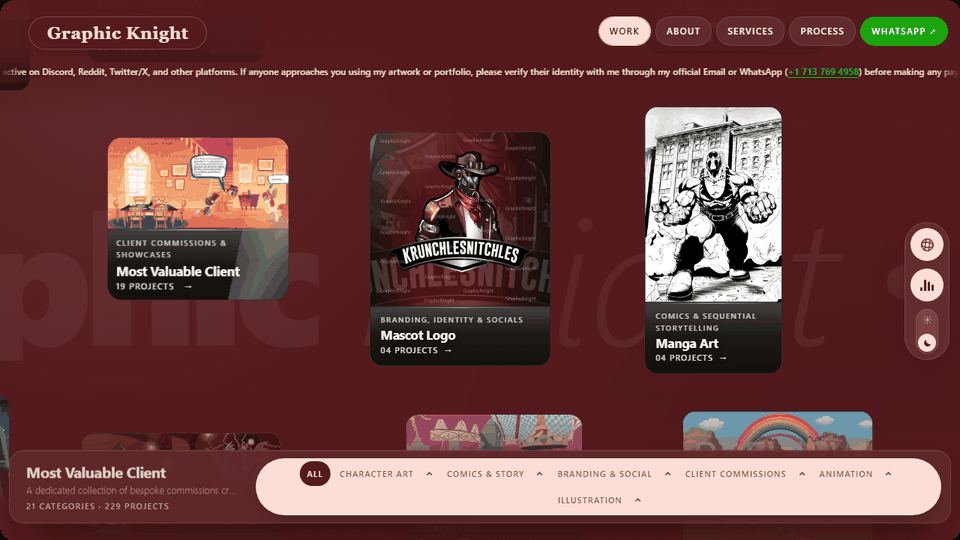
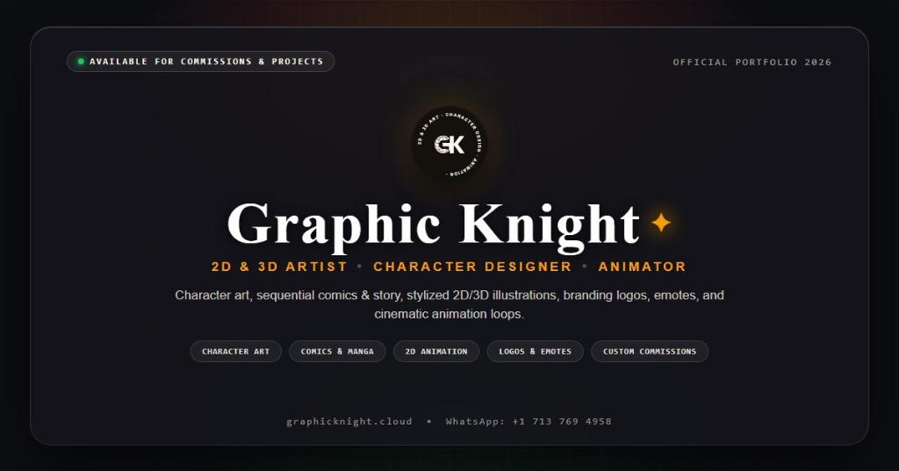

<div align="center">

# GRAPHIC KNIGHT

### 2D & 3D ARTIST, CHARACTER DESIGNER & ANIMATOR

[https://graphicknight.cloud](https://graphicknight.cloud)

<br/>



<br/>

*A high-performance, single-screen creative portfolio engineered with vanilla JavaScript, an ambient canvas physics engine, dynamic chromatic interpolation, and procedural audio synthesis.*

</div>

---

## Live Deployment & Links

- Production Domain: [graphicknight.cloud](https://graphicknight.cloud) (Deployed via Hostinger LiteSpeed Web Server)
- Global Edge Mirror: [graphics-knight-ltd.vercel.app](https://graphics-knight-ltd.vercel.app) (Continuous Deployment via Vercel Edge Network)
- Primary Direct Inquiry: [WhatsApp Direct Message](https://wa.me/17137694958) (+1 713 769 4958)
- External Platform Verification: Active across Discord, Reddit, and Twitter/X. All client engagements and commission agreements must be validated directly via official WhatsApp or email before conducting transactions.

---

## Featured Work & Categories

This portfolio showcases 229 artworks across 21 curated categories:

### 1. Character Art
- Character Design (32 artworks) - Distinctive character concepts, dynamic poses, and full-turnaround reference models.
- SFW Full Body (20 artworks) - Full-body stylized character artworks with detailed anatomy, clothing, and shading.
- Sketches & Line Art (13 artworks) - Raw pencil and digital gesture studies, concept drafts, and expressive line art.
- Furry Art (9 artworks) - Vibrant anthropomorphic character illustrations with expressive features and costumes.
- Reference Sheet (1 artwork) - Multi-angle model sheets with color swatches, expressions, and costume breakdowns.

### 2. Comics & Sequential Storytelling
- Story Continued (15 artworks) - Episodic sequential storytelling and comic scenes crafted for continuing lore.
- Pony Story Artworks (15 artworks) - Narrative pony illustrations capturing key story moments, adventures, and lore.
- Storytelling Artworks (15 artworks) - Rich, atmosphere-heavy story scenes designed to evoke narrative depth and emotion.
- Comic Art (9 artworks) - Dynamic comic pages, inkings, action panels, and narrative sequences.
- Manga Art (4 artworks) - Stylized manga panels, screentone shading, and Japanese-inspired expressive illustrations.
- Pony Art (5 artworks) - Vibrant pony illustrations, colorful character designs, and thematic scenes.

### 3. Branding, Social & Identity
- PFP (Profile Picture) (18 artworks) - High-impact circular and square avatars crafted for Discord, Twitter, Twitch, and gaming.
- Tattoo Design (14 artworks) - Custom tattoo flash, clean linework, stencils, and shaded body art concepts.
- Banners & Headers (8 artworks) - Wide-format social banners for YouTube, Twitter, Twitch, and Discord servers.
- Mascot Logo (4 artworks) - Bold mascot emblems and esports badges with fierce silhouettes and punchy colors.
- Emotes & Badges (3 artworks) - Custom Twitch, Discord, and YouTube subscriber emotes and sub badges.

### 4. Client Commission Showcases
- Most Valuable Client (19 artworks) - A dedicated collection of bespoke commissions crafted for a recurring private client.
- My Honorable Client (14 artworks) - Custom commissioned artworks delivering tailored characters and personal visions.
- My Valuable Client (3 artworks) - Curated client commissions with personalized details, outfits, and scenes.

### 5. Motion & 2D Animation
- 2D Animation (2 video animations) - Hand-crafted 2D animations, motion graphics, loops, and animated character shorts with inline video player embeds.

### 6. Illustration
- Child Book Illustration (6 picture book spreads) - Double-page storytelling spreads, whimsical character sheets, and book illustrations.


---

## Architectural & Technical Highlights

1. Zero-Dependency Vanilla Runtime
   Engineered without external UI frameworks (no React, Vue, or heavy bundle overhead). Built on modern ES6+ and native Web APIs, delivering sub-50ms initial paint times and sustained 60 FPS compositor execution.

2. Interactive 2D Physics & Kinetic Drift Field
   The central artwork viewport functions as an interactive canvas physics simulation. Floating project cards respond to natural velocity decay, spring-loaded edge boundaries, dynamic inertia, and pointer drag-and-drop mechanics.

3. Real-Time Chromatic Adaptation Engine
   The interface continuously recalibrates its atmospheric lighting. Using native CSS color-mix functions, background paper tints and foreground ink contrasts smoothly morph to match the dominant chromatic palette of any hovered artwork or active filter category.

4. Procedural Audio Synthesis Architecture
   Interactive micro-events are paired with a Web Audio API pipeline. Synthesizes spatial acoustic responses on hover, filter selection, and navigation transitions, coupled with a seamless looping background soundscape.

5. Responsive Drawer & Deep-Linking System
   Modal overlays and detail views for services, about, and individual categories are handled through an accessible off-canvas drawer system synchronized with window hash states, enabling clean browser history navigation.

6. Impersonation Protection & Client Verification System
   Includes an integrated persistent marquee notification and dedicated verification protocol to protect clients from third-party impersonators across Discord, Twitter/X, and Reddit, directing all payment authorizations to official channels.

---

## Technology Stack

### Core
- Vanilla JavaScript (ES6+ modular architecture)
- HTML5 Canvas API (interactive particle and physics simulation)
- Web Audio API (procedural audio synthesis and soundscape playback)
- Window History API (hash-based deep-linking and state preservation)

### Styling & Design Systems
- CSS3 Custom Properties (dynamic runtime design tokens)
- CSS color-mix() interpolation for live ambient illumination
- CSS Grid and Flexbox for fluid multi-viewport responsiveness
- Hardware-accelerated CSS transforms and keyframe animation pipelines

### Typography
- Cormorant Garamond (editorial serif display titles)
- Bricolage Grotesque (expressive modern headlines)
- Instrument Sans & Instrument Serif (body prose and narrative accents)
- JetBrains Mono (technical metadata, dimensions, and indexing)
- Poppins (vector seal orbits and emblem badges)

### Deployment & Infrastructure
- Hostinger Cloud Platform (LiteSpeed Web Server with custom rewrite and cache rules)
- Vercel Global Edge Network (automated git-integrated mirrors and fallback distribution)
- Apache / LiteSpeed .htaccess configuration (GZIP/Brotli compression and MIME mapping)


---

## Quick Start & Local Development

### Prerequisites
- Node.js (v18.0.0 or higher recommended)
- Git command-line tools

### Installation & Execution

1. Clone the repository:
   ```bash
   git clone https://github.com/M-isbah234/GraphicsKnight_ltd.git
   cd GraphicsKnight_ltd
   ```

2. Launch local server:
   ```bash
   npm start
   # or run directly with Node
   node server.js
   ```

3. Open in browser:
   Navigate to [http://localhost:3000](http://localhost:3000)

### Production Build

To generate the distribution bundle for Hostinger or static web servers:
```bash
npm run build
```
The compiled output is generated in the `dist/` directory, along with a standalone `dist.zip` ready for direct extraction inside Hostinger `public_html`.

---

## Inquiries & Collaboration

- Primary Direct Contact: [WhatsApp Direct Message](https://wa.me/17137694958) (+1 713 769 4958)
- Studio Location: Utah (UT), United States
- Identity & Verification Notice: Graphic Knight is active on Discord, Reddit, Twitter/X, and freelance platforms. If approached by any individual utilizing Graphic Knight artworks or portfolio assets, verify their credentials through official WhatsApp before issuing any payments.

---

<div align="center">



</div>
